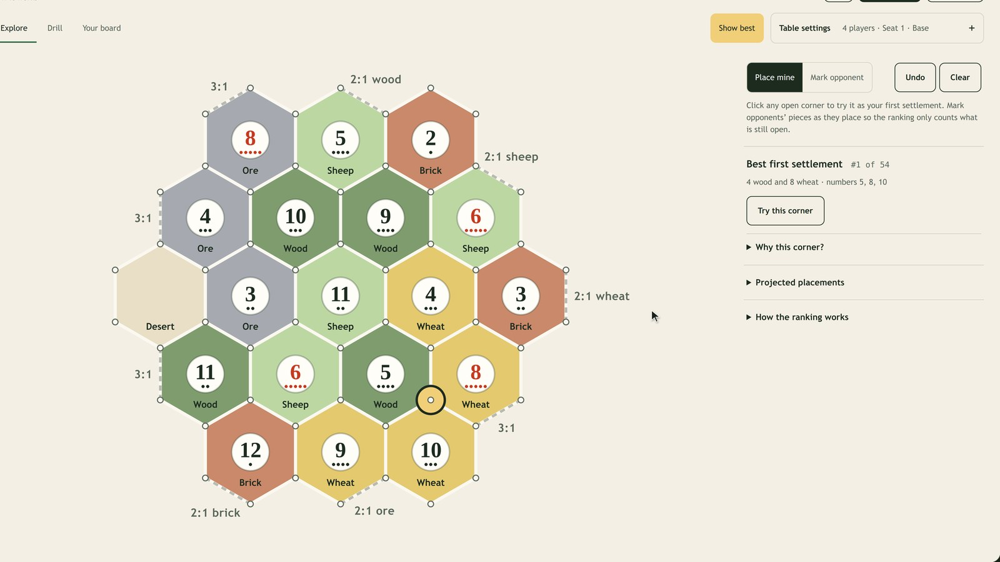
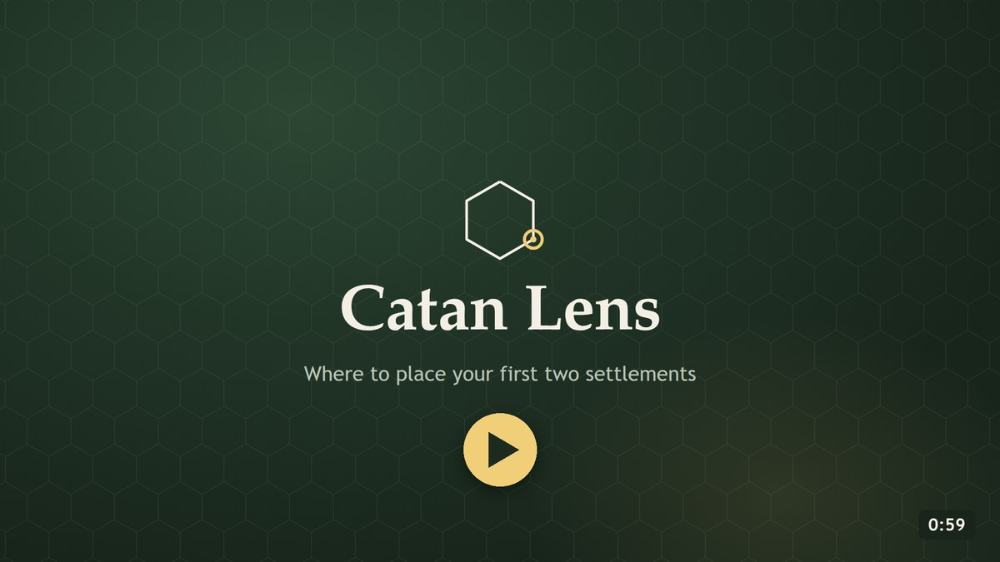
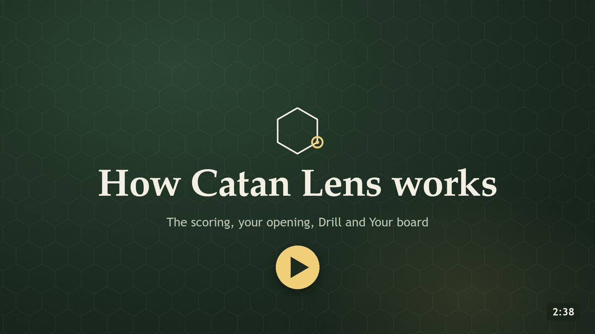
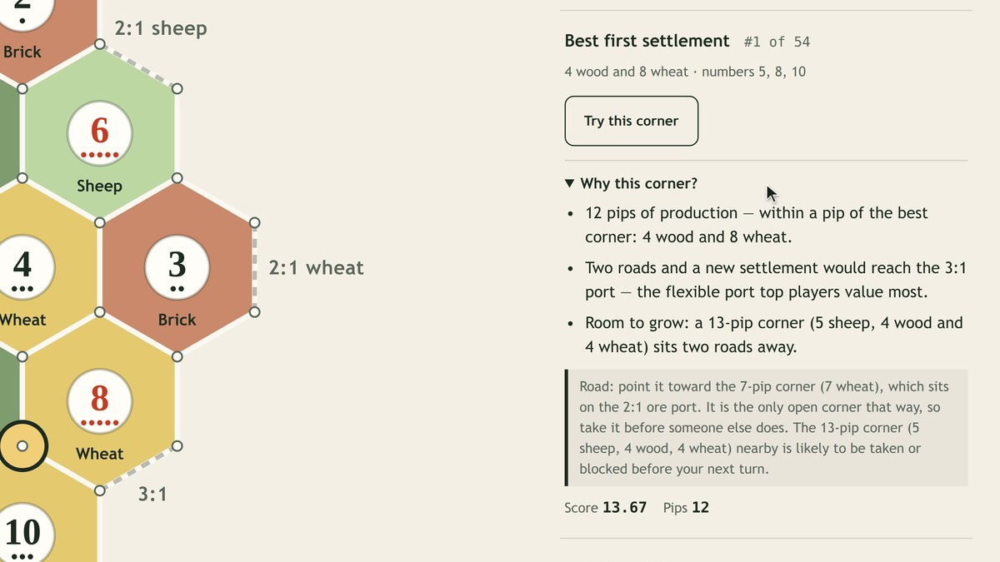
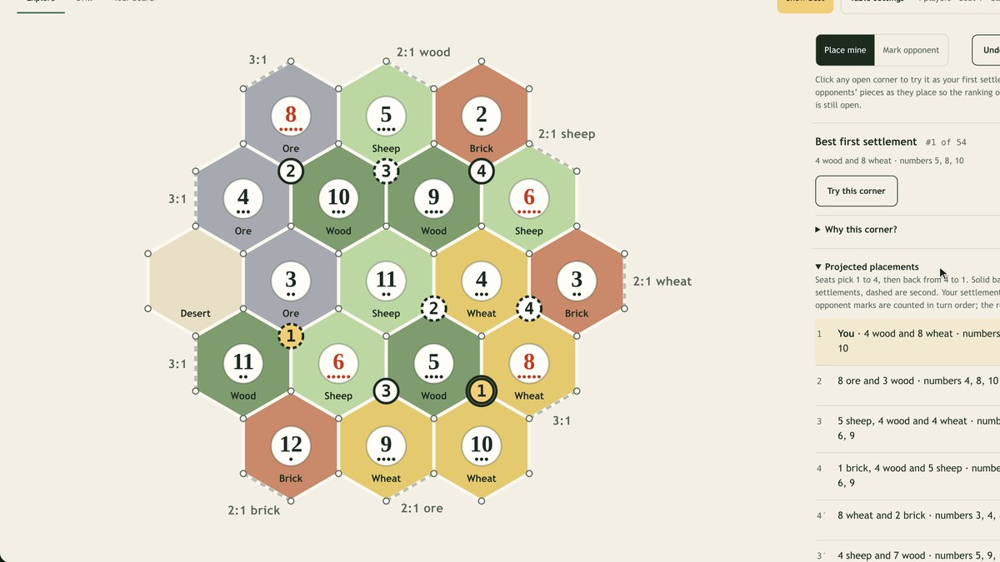
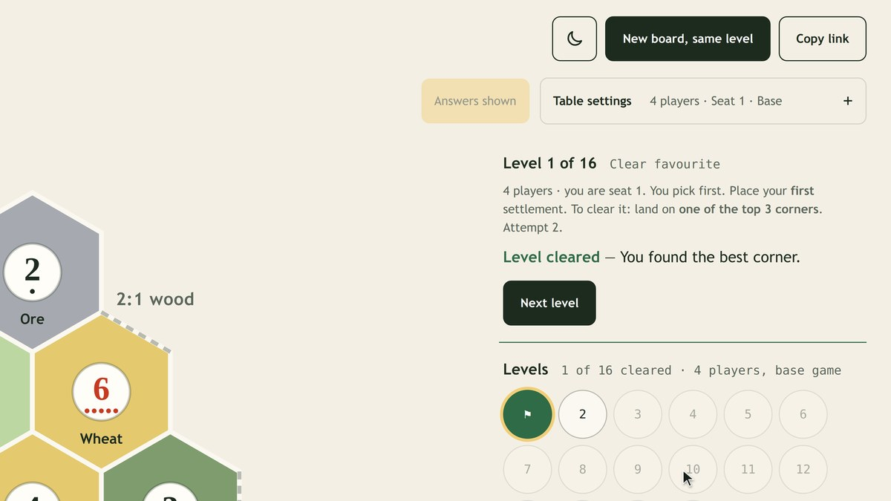
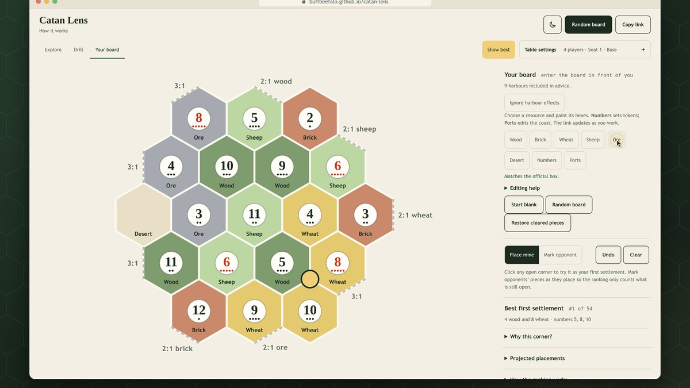

<div align="center">

<picture>
  <source media="(prefers-color-scheme: dark)" srcset="docs/media/logo-dark.svg">
  
</picture>

# Catan Lens

**Where should I put my first two settlements?**

Catan Lens scores every legal corner on a Catan board with rules that strong players agree on,<br>
and explains the best spot in plain sentences. Free, open source, and it runs entirely in your browser.

[](https://github.com/buffbeefalo/catan-lens/actions/workflows/ci.yml)
[](https://github.com/buffbeefalo/catan-lens/releases/latest)
[](LICENSE)
[](package.json)

**[Open the app](https://buffbeefalo.github.io/catan-lens/)** &nbsp;·&nbsp; **[Watch the videos](https://buffbeefalo.github.io/catan-lens/how-it-works.html)** &nbsp;·&nbsp; **[Read how it works](docs/HOW-IT-WORKS.md)**

<a href="https://buffbeefalo.github.io/catan-lens/"></a>

</div>

## See it in action

<table>
<tr>
<td width="50%"><a href="https://buffbeefalo.github.io/catan-lens/how-it-works.html#overview"></a></td>
<td width="50%"><a href="https://buffbeefalo.github.io/catan-lens/how-it-works.html#walkthrough"></a></td>
</tr>
<tr>
<td><b>Catan Lens: plan your opening</b><br>Compare corners, see your resource income, and plan your first builds.</td>
<td><b>How Catan Lens works</b><br>The scoring, opening resources, snake draft, Drill mode and entering your own board.</td>
</tr>
</table>

## What it does

<table>
<tr>
<td width="50%"></td>
<td width="50%"></td>
</tr>
<tr>
<td><b>The best corner, explained.</b> Random boards follow the official setup (3–4 players, or the 5–6 player board). A gold ring marks the best open corner; <i>Why this corner?</i> gives the reasons in plain sentences. Click any other corner for a grade and an explanation of the tradeoffs behind its score.</td>
<td><b>Plays out the draft.</b> Mark opponents as they place and the ranking only counts what is still open. <i>Projected placements</i> shows the model's snake-draft choices; starting-road advice explains conflicts and destinations those choices would occupy. Tap a side of your settlement to place your own road and see how it compares.</td>
</tr>
<tr>
<td></td>
<td></td>
</tr>
<tr>
<td><b>Drill until it is second nature.</b> Sixteen levels, easy to hard, on the table you choose. Hints stay hidden until you commit; a miss shows your rank and offers a fresh board at the same level.</td>
<td><b>Use your real board.</b> Paint the board in front of you, set its numbers and harbours, and every ranking applies to it. Or read it from a screenshot or a photo: tap four corner tokens, then check the guesses. The link carries the whole board, so your table can open it too.</td>
</tr>
</table>

**Turn the opening into a plan.** After the second settlement, see average resource income, missing
resources, your starting hand and the cards still needed for each first build. Preview the same facts
before committing a second corner; blind practice keeps them hidden until you choose.

**Choose your plan, or look ahead.** Rank your own corners for a cities or a roads plan instead of the seat rule,
or switch the ranking to Look-ahead (experimental), which values a corner by the whole opening it leads to.

Light and dark themes: it follows your device, or pick one with the switch in the header. No account, no tracking,
no analysis backend: the app is plain HTML, CSS and JavaScript modules with zero runtime dependencies.

<sub>Unofficial fan tool, not affiliated with or endorsed by Catan GmbH or Catan Studio. CATAN is a trademark of Catan GmbH.</sub>

## Ways to use it

- **Plan an opening at the table.** Set the player count and your seat, enter the real board, and mark
  opponents as they place. Compare second-settlement candidates before committing. For the base game,
  the opening summary answers what you cannot produce and which first build needs the fewest new cards.
- **Practise before the next game.** Drill hides the answer until you commit, explains the result and
  lets you replay the same kind of decision on another board.
- **Review with friends.** Copy a link from Your board to keep explicit tiles, harbours and placement
  order. Everyone can inspect the same opening and discuss its tradeoffs.

[Try a worked example](https://buffbeefalo.github.io/catan-lens/how-it-works.html#worked-example): the same two corners can give the same income but different starting hands and first-build options.

Install it on your phone from the browser menu (Install app, or Add to Home Screen on an iPhone). After one visit
with a connection, most browsers keep an offline copy, so the app and its help page open without one; videos still
need a connection.

## How it works

The score for a corner starts with **production** (the dots on the surrounding number tokens: the ways, out of 36,
that two dice roll each number), weighted by how valuable and how scarce each resource is on this board. Small
bonuses go to wood+brick and wheat+ore pairs, a harbour you can feed, and room to grow; repeating a number costs a
little; a second settlement gets credit for covering what the first lacks. Every rule traces to a published source
(King of Catan's expert group, Colonist.io champion interviews, a 400-game statistical study, the standard Cities &
Knights guide, an IEEE paper on Catan agents).

- [docs/HOW-IT-WORKS.md](docs/HOW-IT-WORKS.md): the full explanation in plain English
- [docs/RESEARCH.md](docs/RESEARCH.md): every source, every weight, and what was deliberately left out
- [docs/ARCHITECTURE.md](docs/ARCHITECTURE.md): how the code fits together

## Does following it win?

Advice is not proof, so this repository tests it. [`bench/catanatron`](bench/catanatron) plays complete four-player
games in [Catanatron](https://github.com/bcollazo/catanatron), an open-source Catan engine with strong bots. Every
seat is Catanatron's value-function bot; one seat's opening settlements come from a different strategy, then it plays
on exactly like the others. Every strategy sees the same boards and seat orders, and the whole benchmark is repeated
under 20 different bot tie-breaking orders, with intervals computed across those runs (see
[HOW-IT-WORKS](docs/HOW-IT-WORKS.md#5-does-following-it-actually-win-games) for why). A fair seat wins 25%.

The current policy also counts legal two-road harbour approaches from inland. Its separate 24,000-game
comparison produced **1,981 wins out of 8,000**, versus **1,980** immediately before the correction and
**2,015** for the bot's own opening. The primary paired difference is +0.0125 percentage points
(approximate 95% interval: −0.7705 to +0.7955). This does not establish an advantage or prove equal
performance. Both versions already include consistent rounding and the owned-harbour fix below.
[Frozen inputs and all games](bench/catanatron/results.md#harbour-reachability-correction-2026-10-09)
keep this comparison separate from the earlier evidence; none of its outcomes tuned the policy.

The earlier owned-harbour policy removes credit for a harbour type you already own. Its separate 24,000-game
comparison produced **1,972 wins out of 8,000**, versus **1,976** before the correction and **1,985**
for the bot's own opening. The correction's four fewer wins give a −0.05 percentage-point difference;
the planned approximate 95% interval is −0.098 to −0.002. Only four win/loss pairs changed, so this
estimate rests on sparse differences. It shows no win-rate gain and is not proof of equal policies.
The [full comparison and raw records](bench/catanatron/results.md#owned-harbour-correction-2026-10-09)
preserve the frozen inputs and explain the limits.

The arithmetic repair makes rounding consistent when the same board is turned. The newest comparison
contains that repair in both versions, so it does not isolate the repair's effect on winning chances.

The table shows the **earlier policy's fresh-seed test on 2026-10-09**, frozen beforehand with no
tuning on its outcomes. All 40,000 games finished. The [methods and raw records](bench/catanatron/results.md)
also preserve the earlier benchmark and its same-seed replication.

| Opening chosen by | Win rate (95% interval) | Games |
|---|---|---|
| Catan Lens settlements and road | 24.3% ± 1.1 | 8,000 |
| Catan Lens settlements, bot's roads | 23.5% ± 1.2 | 8,000 |
| The bot's own opening | 24.5% ± 1.2 | 8,000 |
| Most pips | 16.4% ± 1.1 | 8,000 |
| Random corner | 1.5% ± 0.2 | 8,000 |

Across matched runs, Lens led most-pips by **7.9 percentage points** (95% interval: 6.5 to 9.3). Its
difference from the bot's own opening was −0.2 points (−1.8 to +1.3): no clear advantage, and no proof
of equal performance. These are four-player base-game bot results; they do not predict a person's win
rate or validate other table sizes or Cities & Knights.

A deterministic report of what each strategy's opening looks like (`npm run report`) describes the
resource tradeoffs: taking the most pips wins raw production, as it must by construction, while Lens
covers more resources, spreads across more numbers, and holds more of the wheat/ore pair that builds cities.

## Run it

Node 22 or newer. No install is needed to run the app:

```sh
npm start          # http://127.0.0.1:8080/
npm test           # scoring, geometry, board, drill and local-server tests
npm install        # once, for the browser tests
npx playwright install chromium
npm run e2e        # browser walkthroughs and interaction tests against the local server
npm run report     # the deterministic opening report
```

Any static file host works: the app is plain HTML, CSS and JavaScript modules in [`public/`](public).
The MP4s are attached to [GitHub Releases](https://github.com/buffbeefalo/catan-lens/releases/latest),
not stored in git. Copy both into `public/media/` to watch them locally; captions and transcripts are
already included. The local server supports video seeking and streams only the requested bytes.

## Build on it

Ideas and fixes are welcome; see [CONTRIBUTING.md](CONTRIBUTING.md). Good places to start: a denial term (valuing the
corners your pick takes away from others), Seafarers boards, real Cities & Knights rules instead of re-weighting,
translations, or new drill levels. Keep every scoring change tied to a source in RESEARCH.md and to a test.

## The demo videos

Both videos are rebuilt from the real app by [`video/`](video): a script drives the app, the corners it clicks come from
the app's own scoring code, and a renderer draws the camera moves, cursor and cards frame by frame. The narration is
a computer voice, spoken locally by [Chatterbox](https://huggingface.co/ResembleAI/chatterbox) (MIT); every line is
checked word for word by a speech recogniser, every "Catan" is checked by a phonetic transcriber for the cuh-TAHN
pronunciation, and `video/qa.py` checks loudness, sync, captions and picture quality before a release. See
[video/README.md](video/README.md).

## License

[MIT](LICENSE), except [`bench/catanatron/`](bench/catanatron), which imports the GPL-licensed Catanatron and is
therefore GPL-3.0-or-later (see [NOTICE](NOTICE)).
